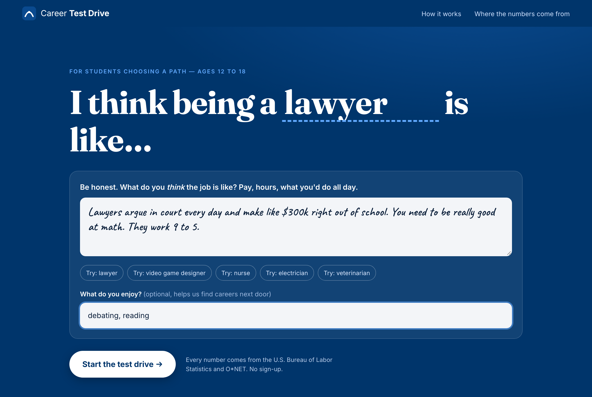

# Career Test Drive

**Bust career myths with real data, then test-drive the job before you pick a college major.**

Students aged 12–18 type a career and what they *believe* about it ("lawyers argue in court every day
and make $300k right out of school"). Five AI agents check each belief against official U.S. government
data (BLS + O*NET), let the student "drive" three realistic moments from the job, and draw the road from
high-school classes to senior roles, with real salaries at every stage.

Every number on screen comes from bundled government data. A grounding check rejects any number an agent
invents before the student ever sees it.

**What a student can do**
- **Discover**: don't know what you want? Pick strengths, hobbies, favorite subjects, values and how much
  school you'd do. Suggestions unlock and get more specific the more you share: fields at 5 inputs,
  careers at 9, careers plus majors and schools in your state at 14.
- **Test-drive a career**: myths vs. facts, an explanation in plain words, a narrated "day in the life," pay at the
  start / typical / senior level **in your state**, college majors with graduates' earnings 1 and 5 years
  out, schools that offer them, and a map of every job in the field.
- **Compare**: save careers with ♡ and compare up to 4 side by side (pay, growth, education, majors,
  high-school classes, skills, hours, work setting).
- **Career map**: all 774 careers by field (rows) × the main capability used (columns).



---

## Run it locally (about 3 minutes)

You need **Python 3.11+** and a `PORTKEY_API_KEY` (or `OPENAI_API_KEY`).

```bash
git clone https://github.com/ssaadeld-som/career-test-drive.git
cd career-test-drive
python3 -m venv .venv
source .venv/bin/activate          # Windows: .venv\Scripts\activate
pip install -r requirements.txt
python app.py
```

Then open **http://127.0.0.1:8000** in your browser.

### Where the API key goes

The app looks for a `.env` file in **this repo folder first, then in the folder above it**, so a shared
`submissions/.env` works without copying anything:

```
submissions/
├── .env                 <- PORTKEY_API_KEY=... (or OPENAI_API_KEY=...)
└── career-test-drive/   <- this repo
```

See `.env.example` for every setting. The model is `gpt-6-luna` (the course key's model). The key is
never printed, logged, or committed.

To check the setup without spending tokens: open http://127.0.0.1:8000/api/health. It should report
`"api_key_found": true` and `"careers": 774`.

### Try these

| Career | Belief to type |
|---|---|
| lawyer | Lawyers argue in court every day and make $300k right out of school. |
| video game designer | Game designers play games all day and it's chill. |
| electrician | Electricians don't make much money and you don't need any school. |
| teacher | Teachers get summers off and work short days. |

Or click a **Try:** chip under the text box.

---

## How it works

```
student text
   │
   ├─ 0. Prescreen (regex, free): blocks obvious prompt injection, length cap, budget + rate limit
   ├─ 1. Gatekeeper agent: injection / off-topic / personal info / student-in-distress (988)
   ├─ 2. Scout agent + search_careers tool: finds the official occupation among 774 (O*NET)
   │                                        and splits beliefs into checkable claims
   └─ 3. In parallel:
         ├─ Fact-Checker agent: true / partly / myth / no data, citing numbered facts
         ├─ Test-Drive agent:   3 decision scenarios built on real O*NET tasks   (cached per career)
         └─ Pathway agent + lookup_related tool: HS → degree → license → entry/mid/senior,
                                                   plus careers next door   (cached per career)
```

* **Grounded numbers.** Agents receive a numbered fact sheet (`[W1] Median annual wage: $151,160`).
  An output validator extracts every number they write. If one isn't in the facts, the answer is sent
  back for one retry. On a second failure the card is downgraded to "no data" instead of showing a guess.
* **Cost controls.** Per-agent `UsageLimits` (max requests, tool calls, tokens), per-session and daily
  dollar caps, a rate limit, prompt caching (stable prefixes and `prompt_cache_key`), and on-disk
  caching of the career-level agents.
* **Live telemetry.** The "Under the hood" panel shows each agent's tool calls, tokens (input, cached,
  output), time and cost for the run. Every run is appended to `logs/runs.jsonl`.

Plus, outside the per-student pipeline:
- **Storyteller agent** (cached per career): plain-words explanation, "not to be confused with," kinds of the
  job (only names from O*NET's alternate titles), and a 6–8 scene day built on real tasks.
- **Field Guide agent** (cached per field): one plain sentence per job for the field map.
- **Profiler agent → matching engine → Advisor agent** (Discover): reads free-text hobbies into interest
  types and knowledge areas, ranks 774 careers deterministically, then explains each pick with numbers
  checked against the data.

## Data (all public, bundled)

| Source | What we use | License |
|---|---|---|
| O*NET 31.0 database | tasks, work context, work styles, skills, interests, related jobs | CC BY 4.0 |
| BLS OEWS, May 2024 | annual wage percentiles (10th–90th) | public domain |
| BLS Employment Projections 2025–35 | growth, openings, entry education, training | public domain |
| BLS OEWS state file, May 2024 | wages and employment by state | public domain |
| College Scorecard (U.S. Dept. of Education) | majors, schools, graduates' earnings 1 and 5 yrs out, cost, grad rate | public domain |
| NCES CIP 2020 – SOC 2018 crosswalk | links college majors to occupations | public domain |

All processed files in `data/` (~11 MB) are pre-built and committed, so you don't need the raw files.
To rebuild, put the raw downloads in `data/raw/` and run `python scripts/build_data.py && python scripts/build_extras.py`.
Every field is documented in [docs/SCHEMA.md](docs/SCHEMA.md).

## Tests and experiments

```bash
python -m pytest -q                      # 17 offline tests (no key, no cost)
python scripts/safety_demo.py            # live attacks through the real pipeline
python scripts/eval_cost_quality.py      # cost vs. accuracy of 4 Fact-Checker configurations
python scripts/measure_runs.py           # 15 measured runs for tokenomics
```

Results from our runs are in `logs/` (`eval_results.json`, `safety_results.json`,
`measure_summary.json`, `measured_runs.jsonl`).

## Project layout

```
app.py                 start the server
backend/
  agents.py            the five agents, tools, validators, usage limits
  pipeline.py          orchestration, caching, budgets, run logging
  data.py              career search + numbered fact sheets
  grounding.py         "every number must exist in the facts" check
  guard.py             free regex prescreen
  prompts/*.md         one prompt per agent
frontend/              plain HTML/CSS/JS (no build step)
data/careers.json      processed government data
scripts/               data build, experiments, measurements
tests/                 offline safety tests
```

Built for MGT 409 *AI Foundations for Managers* (Yale SOM, Fall 2026). This is not career advice. Talk to
people in the job and to a school counselor before you decide.
